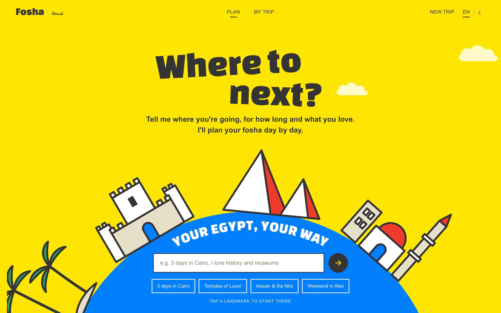
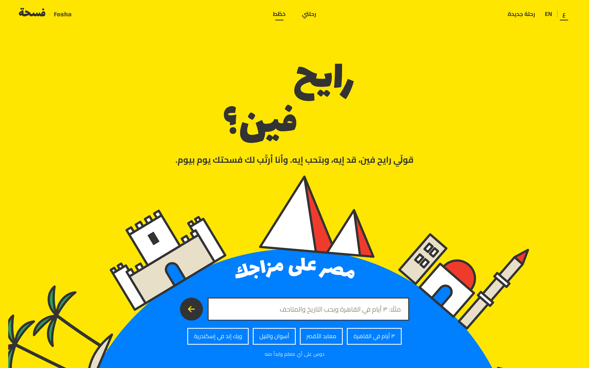
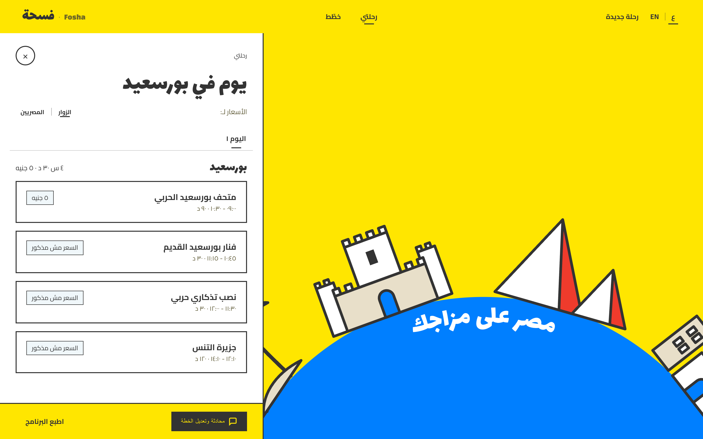
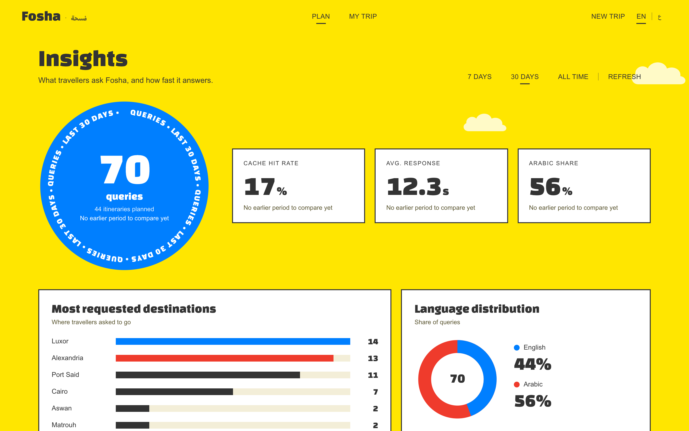

# Fosha · فسحة

**Egypt, your way.** Fosha (*فسحة*, Egyptian Arabic for "an outing") is an AI travel assistant for Egypt, built as the RehlaGuide DEPI capstone. Tell it, in Arabic or English, where you're going, for how long and what you love ("عايزة اطلع يوم مع صحابي. بورسعيد", "3 days in Luxor, I love temples, we're a couple") and it builds a day-by-day plan that respects opening hours, visit lengths and travel time, suggests where to stay and how to get around, and lets you change the plan by chatting.


**Contents:** [Features](#1-features) · [Screenshots](#2-screenshots) · [Quick start](#3-quick-start) · [Deploying](#deploying-one-web-service) · [How it works](#4-how-it-works) · [Repository](#5-repository-structure) · [API](#6-api) · [Web app](#7-web-app) · [Retrieval](#8-knowledge-base-and-retrieval) · [Agent](#9-agent-and-itinerary-engine) · [Testing](#10-testing) · [Limitations](#11-known-limitations) · [Data & credits](#13-data-sources-and-credits)

---

## 1. Features

- **Arabic (Egyptian) and English**, both ways: understands either, answers in the language you wrote in; the UI switches fully to RTL Arabic.
- **Real constraints, no guessing:** opening hours, visit durations, travel time and day length are enforced by plain Python, not the model. Unknown hours or prices are shown as unknown.
- **Anywhere in Egypt:** 30 curated attractions on the globe's regions, and any other town (Port Said, Ismailia, Fayoum, Dahab, Rosetta…) looked up live in OpenStreetMap, Wikivoyage and Wikidata.
- **Personalised suggestions** for 2+ day trips: hotel areas and transport ranked by your interests, budget, who's travelling and the places actually in your plan, each with a "why".
- **Edit by chatting:** "ممكن نحط كنيسة الأنبا بيشوي بعد الفنار", "remove the museum", "make it 2 days".
- **Asks only what's missing**, with one-tap answers that fit the trip (a one-day trip is offered Cairo or Alexandria, not Aswan).
- **Fast:** about 1-2 s per answer with Groq (Gemini as a backup); repeated questions come from a cache.
- **Printable itinerary**, and an **insights dashboard** fed by real usage.

## 2. Screenshots

| Landing (English) | Landing (Arabic, right-to-left) |
|---|---|
|  |  |





## 3. Quick start

Requirements: Python 3.12 (see `.python-version`; the project requires `<3.13`) with [uv](https://docs.astral.sh/uv/), and Node 18+ (only to rebuild the web app).

```bash
uv sync                          # Python dependencies (add --extra tracking for MLflow)
uv run python -m rag.ingest      # build the vector index (once, and again after changing the embedding model)
cp .env.example .env             # Windows: copy .env.example .env, then add at least one key
cd frontend && npm install && npm run build && cd ..   # the web app (frontend/dist is also committed)
```

`.env` (at least one key; Groq is tried first, Gemini is the backup):
```
GROQ_API_KEY=your-groq-key        # https://console.groq.com
GEMINI_API_KEY=your-gemini-key    # https://aistudio.google.com/apikey
GEMINI_MODEL=gemini-3-flash-preview
```
`.env` is gitignored: never commit it or put a real key in `.env.example`.

### Running the app

Run **one** of these modes (each starts a single server that serves both the API and the web app), then open **http://localhost:8000** (dashboard: **http://localhost:8000/dashboard**).

**Full mode**: real LLM and Chroma vector search. Needs an LLM key and the index from `rag.ingest`.

```bash
# bash / macOS / Linux
REHLA_SEARCH=vector uv run uvicorn api.server:app --reload
```
```bat
:: Windows cmd
set REHLA_SEARCH=vector
uv run uvicorn api.server:app --reload
```
```powershell
# PowerShell
$env:REHLA_SEARCH="vector"
uv run uvicorn api.server:app --reload
```

**Keyword mode**: real LLM, no index. This is the default when `REHLA_SEARCH` is not set, so plain `uvicorn api.server:app` does **not** use Chroma. It also works where `sentence-transformers` cannot install (for example Intel Macs).

```bash
uv run uvicorn api.server:app --reload
```

**Offline demo**: no keys needed; rule-based understanding and template replies (LLM health metrics stay empty in this mode).

```bash
REHLA_DEMO=1 uv run uvicorn api.server:app --reload     # cmd: set REHLA_DEMO=1    PowerShell: $env:REHLA_DEMO="1"
```

Check which search mode is active:

```bash
curl http://localhost:8000/api/v1/health
# {"ok": true, "demo": false, "search": "vector"}
```

Variables set with `set` or `$env:` last for the current terminal session only. Clear one with `set REHLA_SEARCH=` (cmd) or `Remove-Item Env:REHLA_SEARCH` (PowerShell).

### Other commands

```bash
uv run pytest -q                                   # tests (add --extra tracking to include the MLflow tests)
uv run python -m agents.planner "3 days in Luxor"  # the planner from the terminal
uv run python -m api.seed                          # sample dashboard events (--clear removes them; excluded from the dashboard unless asked for)
```

### Deploying (one web service)

Fosha deploys as **one** service: the FastAPI app serves the API and the built web app on a single port, so there's no separate frontend hosting. A static host on its own (GitHub Pages, Netlify) can't run it, because the planner is Python.

```bash
docker build -t fosha .
docker run -p 8000:8000 -e GROQ_API_KEY=your-key fosha     # → http://localhost:8000
```

The image (about 290 MB) builds the React app, installs only the web dependencies (`requirements-deploy.txt`) and runs with keyword search; the model still understands requests and writes replies. For full vector search, build with `--build-arg SEARCH=vector` (adds torch, sentence-transformers and chromadb, and builds the index at build time; a much larger image).

**On Render (free tier):** push the repo to GitHub → in Render choose **New + → Blueprint** and pick the repository (it reads `render.yaml`) → paste `GROQ_API_KEY` (and optionally `GEMINI_API_KEY`) when asked → deploy. Other Docker hosts work the same way (Railway, Fly.io, Google Cloud Run, Hugging Face Spaces with the Docker SDK): point them at the `Dockerfile` and set the keys as environment variables. The app listens on `$PORT` when the platform sets it.

Things to know when hosting:
- **Keys** are environment variables on the host. Never put them in the image, the repo or `render.yaml`.
- **Storage is temporary** on most free hosts: the analytics log and the place/translation caches live in `data/` and reset on redeploy (caches simply refill). Attach a disk if you want the dashboard history to survive.
- **Free tiers sleep:** the first request after idle can take ~30-60 s on Render's free plan.
- **Model limits:** free Groq/Gemini quotas are shared by all visitors; the app falls back between models, then shows an error.

## 4. How it works

```
User message (Arabic / English)  + the current plan, if any
        │
        ├─ editing request? ── agents/editor.py: the model picks changes by id from real places,
        │                       scheduler.time_day re-times the day
        ▼
agents/intent.py      LLM extracts JSON (days, place, interests, budget, group…) → Python validates it
        │
        ├─ place outside the dataset? ── agents/places_online.py: OpenStreetMap → Wikivoyage → Wikidata
        ▼
agents/retrieval_adapter.py → rag/retriever.py → ChromaDB (or keyword search)
        ▼
agents/scheduler.py   opening hours, travel time, day window, grouping   (plain Python)
        ▼
agents/recommendations.py   hotel areas + transport ranked for this traveller   (plain Python)
        ▼
agents/planner.py     LLM writes a 2-4 sentence reply → guard rejects invented times/prices
        ▼
api/server.py (FastAPI: cache, analytics) → frontend (React): chat, trip sheet, print, dashboard
```

**Design rule:** the language model only *understands* requests and *words* replies. Everything that must be correct (which places exist, hours, travel, prices, what fits in a day) is deterministic Python, so a model mistake can't produce an impossible plan or an invented price.

## 5. Repository structure

```
RehlaGuide/
├── agents/                      the travel agent
│   ├── intent.py                message → validated trip request
│   ├── planner.py               full pipeline: plan_trip(); short reply + guard
│   ├── editor.py                "put X after Y" edits of the current plan
│   ├── scheduler.py             build_itinerary(), time_day()
│   ├── recommendations.py       personalised hotel/transport ranking + clarification wording
│   ├── places_online.py         any Egyptian town via OpenStreetMap / Wikivoyage / Wikidata
│   ├── llm.py                   the only file that calls a model (Groq, Gemini)
│   ├── attractions.py hours.py pricing.py travel.py retrieval_adapter.py
│   └── data/                    hours, coordinates, recommendation catalogue
├── rag/                         knowledge base: ingest, retriever, evaluation
├── api/
│   ├── server.py                FastAPI app: /api/v1/chat, /api/v1/analytics, serves the web app
│   ├── analytics.py             query log + dashboard aggregates
│   ├── demo.py                  offline demo mode (rule-based)
│   └── seed.py                  sample dashboard events
├── frontend/                    React + TypeScript (Vite)
│   ├── src/App.tsx              app state, chat calls
│   ├── src/components/          GlobeCanvas, ChatModal, TripSheet, PrintItinerary, DashboardView, …
│   ├── src/i18n.ts              English/Arabic strings and Arabic place names
│   └── dist/                    built app served by the API
├── data/raw_attractions.json    the curated dataset (30 attractions)
├── Dockerfile, render.yaml       one-service deployment (requirements-deploy.txt: web-only deps)
├── docs/                        README screenshots
└── tests/                       pytest suite (models and network faked)
```

## 6. API

| Endpoint | Purpose |
|---|---|
| `POST /api/v1/chat` `{"message": "...", "context"?: {"intent": {...}, "days": [[ids]]}}` | Plan, clarify or edit. Returns `plan_trip()`'s result (below) with each stop enriched (Arabic name, category, description, prices, coordinates, source) plus `cached` and `response_ms`. |
| `GET /api/v1/analytics?days=7` | Dashboard aggregates over real usage (`days=0` = all time). |
| `GET /api/v1/health` | `{"ok": true, "demo": bool, "search": "vector" or "keyword"}` |

`plan_trip` never raises. It returns `{"ok": False, "error": "..."}` or:
```python
{"ok": True,
 "status": "planned" | "needs_clarification" | "unsupported_region" | "out_of_scope" | "no_results" | "edit_not_applied",
 "language": "ar" | "en",
 "reply": "short text for the chat",
 "intent": {...},                     # the validated request
 "itinerary": {...},                  # when planned: days, stops, unscheduled, warnings, recommendations
 "suggested_regions": [...],          # with needs_clarification: regions that fit the trip length
 "edited": True}                      # when the plan was edited rather than re-planned
```

## 7. Web app

React + TypeScript (Vite) in `frontend/`, built into `frontend/dist` and served by the API.

- **Landing:** an azure globe rises from the bottom of the page with Egyptian landmarks on its rim (Qaitbay, the Pyramids, a Cairo mosque, Sinai, the Red Sea, a Karnak pylon, a felucca, Nubian houses, the White Desert, Siwa palms). It turns slowly, can be dragged, and a tap on a landmark starts a trip there. The input box and suggestions sit on the globe.
- **Chat:** follow-up questions come with one-tap answers; replies are short; plans show as a card that opens the trip sheet.
- **Trip sheet:** day tabs, a timeline of stops (expand for description, notes, source), visitor/Egyptian prices, personalised hotel and transport picks with reasons.
- **Print:** prints a dedicated document with every day and stop, travel, prices, notes, picks and sources (`PrintItinerary.tsx`), not a picture of the window.
- **Dashboard (`/dashboard`):** total questions, plans made, cache hit rate, response time, Arabic share (each against the previous period), top destinations, regions and attractions. Only real chats count.
- **Languages:** English (LTR) and Arabic (RTL), including Arabic names for places and towns.
- **Style:** DESIGN.md's storybook look (Signal Yellow sky, azure globe, Changa One display type, flat colour, ink outlines), with Lalezar + Cairo for Arabic.

## 8. Knowledge base and retrieval

### Dataset - `data/raw_attractions.json`
30 attractions across 10 regions (Cairo, Giza, Luxor, Aswan, Alexandria, Sharm El Sheikh, Saint Catherine, Hurghada, Siwa, Farafra) and 10 categories (Museum, Archaeological Site, Temple, Fortress, Cultural Center, National Park, Monastery, Aquarium, Island / Beach, Historic Oasis).

Each record has: `id`, `name`, `city`, `region`, `category`, `description`, `opening_hours` (free text), `ticket_price_egyptian_adult_egp`, `ticket_price_foreigner_adult_egp`, `estimated_visit_duration_min`, `source_url`, `last_verified`.

### Ingestion - `rag/ingest.py`
- Builds one text document per attraction (name, region, category, description, hours, prices, duration).
- Stores metadata for filtering: `id`, `name`, `region`, `category`, both prices, `estimated_duration_hours`.
- Embeds with `paraphrase-multilingual-MiniLM-L12-v2` (multilingual sentence-transformer, vectors normalised) and persists to ChromaDB in `data/chroma_db/`. Ingest and the retriever both pass `normalize_embeddings=True`; the distance cutoff in `agents/retrieval_adapter.py` assumes unit vectors.
- Deletes the existing index before rebuilding. Without this, every run appended another copy and the index grew to 100 rows for 30 places.

### Retrieval - `rag/retriever.py`
```python
search_attractions(query, region=None, category=None, max_duration=None, top_k=5)
```
Returns a list of `{"content": str, "metadata": {...}, "relevance_score": float}`.

- Filters are exact-match on `region` and `category`, and `<=` on `estimated_duration_hours` (hours, not minutes). Multiple filters are combined with AND.
- `relevance_score` is a Chroma **distance**: lower means closer, not higher.
- Only one region can be passed per call.

### Evaluation - `rag/eval.py`
```bash
uv run python -m rag.eval              # full evaluation
uv run python -m rag.eval --validate   # check the dataset only (no model, no DB)
uv run python -m rag.eval --json out.json
```
51 labelled queries with graded relevance (2 = the place the query is about, 1 = acceptable), in five slices: semantic, filtered, intent, Arabic and out-of-scope. It also checks index health (every attraction exactly once), filter integrity and duplicate results.

Latest results on a healthy index (30 rows, 30/30 attractions), default model `paraphrase-multilingual-MiniLM-L12-v2` with normalised vectors:

| Slice | n | Hit@3 | Recall@3 | nDCG@3 | MRR |
|---|---|---|---|---|---|
| Headline (semantic + intent, unfiltered) | 31 | 96.8% | 82.5% | 85.6% | 0.930 (MRR@5) |
| Semantic | 27 | 96.3% | 82.7% | 86.0% | 0.938 |
| Filtered | 10 | 100% | 91.7% | 94.7% | 1.000 |
| Intent | 4 | 100% | 81.2% | 83.0% | 0.875 |
| **Arabic** | 28 | **64.3%** | 55.4% | 54.3% | 0.568 |

Note: the Arabic slice has 28 cases (22 Egyptian-dialect and conversational queries were added to the original 6). The 83.3% quoted for the original 6 cases was optimistic: on the wider slice Hit@3 is 64.3%, still well above the English-only model's 50.0% on 6 cases but far from the English numbers.

Headline Hit@1 is 90.3%. Filter integrity: 0 violations. Duplicates in top-5: 0.

### Comparing embedding models

The model is read from the `RAG_EMBEDDING_MODEL` environment variable (default `paraphrase-multilingual-MiniLM-L12-v2`). Ingest, the retriever and the evaluation all use it, and each non-default model gets its own index folder (`data/chroma_db_<model>/`), so indexes never mix and the default one is never overwritten. After changing the default in `rag/config.py`, rebuild the default index with `uv run python -m rag.ingest`: old and new vectors have the same size (384), so a stale index gives wrong results without any error.

Results of the three runs that led to the current default (headline = unfiltered semantic + intent queries):

| Run | Headline Hit@3 | Headline MRR@5 | Arabic Hit@3 | Arabic MRR |
|---|---|---|---|---|
| `all-MiniLM-L6-v2` (previous default) | 96.8% | 0.935 | 50.0% | 0.222 |
| `paraphrase-multilingual-MiniLM-L12-v2`, not normalised | 93.5% | 0.903 | 83.3% | 0.700 |
| `paraphrase-multilingual-MiniLM-L12-v2`, normalised (current default) | 96.8% | 0.930 | 83.3% (6 cases) / 64.3% (28 cases) | 0.764 / 0.568 |

To compare against the previous model, evaluate it explicitly (the report header prints the model used; check it, because a variable that was not applied silently evaluates the default):

```bat
:: Windows cmd
set RAG_EMBEDDING_MODEL=all-MiniLM-L6-v2
uv run python -m rag.ingest
uv run --extra tracking python -m rag.eval --mlflow --run-name minilm-baseline --experiment rehlaguide-rag-eval
set RAG_EMBEDDING_MODEL=
```
```powershell
# PowerShell
$env:RAG_EMBEDDING_MODEL="all-MiniLM-L6-v2"
uv run python -m rag.ingest
uv run --extra tracking python -m rag.eval --mlflow --run-name minilm-baseline --experiment rehlaguide-rag-eval
Remove-Item Env:RAG_EMBEDDING_MODEL      # back to the default model
```
```bash
# bash
RAG_EMBEDDING_MODEL=all-MiniLM-L6-v2 uv run python -m rag.ingest
RAG_EMBEDDING_MODEL=all-MiniLM-L6-v2 uv run --extra tracking python -m rag.eval --mlflow --run-name minilm-baseline --experiment rehlaguide-rag-eval
```

A model is only worth adopting if the **Arabic** slice improves without a clear drop in the **headline** English numbers. Models that need `query:` / `passage:` prefixes (the e5 family) are not supported by this switch.

Findings:
- English retrieval stays strong. The one English miss is *"papyri, sarcophagi, jewelry and royal statues"* (the previous model missed *"Step Pyramid and the Imhotep Museum"* instead). On the original 6 Arabic cases, misses went from 3 to 1: *"معبد الكرنك في الأقصر"*.
- Without normalisation the multilingual model's Chroma distances were about 20-34 instead of about 1, which breaks the distance cutoff (every result looked "too far") and made the in-scope and out-of-scope ranges overlap heavily. Normalised vectors fixed both and brought the English numbers back to the previous level.
- With normalised vectors the in-scope and out-of-scope top-1 distances still overlap slightly (worst in-scope 1.225, best out-of-scope 1.207; previously 1.372 and 1.391), so a "no result" distance cutoff is only a soft signal. The planner leaves out-of-scope requests to the intent step, and the cutoff in `agents/retrieval_adapter.py` stays at 1.38 (no in-scope case is above it).
- The labelled sets are small (6 Arabic and 4 intent cases): one case moves a slice by 17-25 points, so treat these numbers as a direction, not a precise measurement.
- The agent still builds an English search query in the intent step (`agents/intent.py`), so the Arabic gain only reaches users if that query is Arabic or bilingual. The end-to-end evaluation (`agents/eval_e2e.py` on the `feat/arabic-e2e-eval` branch) measures that real path.

### Experiment tracking - MLflow (optional)

`rag/tracking.py` logs each evaluation as an MLflow run, so embedding models and retrieval changes can be compared over time. MLflow is an optional extra; the app and the tests do not need it. Run everything from the repository root.

```bash
uv sync --extra tracking
uv run python -m rag.ingest                                   # the index must exist before evaluating
uv run --extra tracking python -m rag.eval --mlflow                                   # log to a local mlflow.db
uv run --extra tracking python -m rag.eval --mlflow --run-name minilm-baseline --experiment rehlaguide-rag-eval
```

Open the MLflow UI (in a separate terminal; stop it with `Ctrl+C`):

```bash
uv run --extra tracking mlflow ui --backend-store-uri sqlite:///mlflow.db
```

Then open **http://127.0.0.1:5000**, choose the `rehlaguide-rag-eval` experiment, tick two or more runs and press **Compare**. Use the relative `sqlite:///mlflow.db` URI: an absolute path containing spaces breaks it. If port 5000 is busy, add `--port 5001`. Runs are stored in `mlflow.db` (gitignored). Use `--tracking-uri` or `MLFLOW_TRACKING_URI` to point at a shared MLflow server.

Each run stores: **params** (embedding model, dataset size and hash, headline n, raw attraction count, the number of cases per slice such as `n_arabic`), the git commit as a tag, **11 key metrics** and the full JSON report as the `eval_report.json` artifact (every metric at every K for every slice, and every case with expected vs retrieved ids). The key metrics (`KEY_METRICS` in `rag/tracking.py`):

| Metric | Meaning | Expected |
|---|---|---|
| `headline.hit_at_3` | a relevant place is in the top 3 (the main number) | higher is better |
| `headline.hit_at_1` | the first result is relevant | higher is better |
| `headline.mrr` | how high the first relevant place ranks (MRR@5) | higher is better |
| `headline.ndcg_at_3` | ranking quality when several places are relevant | higher is better |
| `slice.arabic.hit_at_3`, `slice.arabic.mrr` | the same on the Arabic queries | higher is better |
| `filter_violations` | a result that breaks its region/category/duration filter | 0 |
| `cases_with_duplicates` | the same place twice in the top 5 | 0 |
| `index_healthy` | every attraction indexed exactly once | 1 |
| `distance.in_scope_top1_max` | worst top-1 distance of a valid request | lower; below the next row |
| `distance.out_of_scope_top1_min` | best top-1 distance of an out-of-scope request | higher |

Precision@K is left out on purpose: most queries have one or two relevant places, so it cannot approach 1 and says little. Runs with the same `dataset_hash` are directly comparable.

Note: `pyproject.toml` pins `scipy<1.18` in the `tracking` extra. The project forces `numpy<2` (`override-dependencies`, which makes uv ignore the numpy requirement of other packages), and SciPy 1.18 needs NumPy 2.

---

## 9. Agent and itinerary engine

### 9.1 Tools

All tools return `{"ok": True, ...}` or `{"ok": False, "error": "..."}`. None of them raises on bad input.

| Tool (file) | Input | Output |
|---|---|---|
| `get_attraction_details` (`attractions.py`) | `attraction_id` | all fields of the attraction |
| `check_opening_hours` (`hours.py`) | `attraction_id`, `day` (weekday name or ISO date), `start` ("HH:MM"), optional `duration_min` | `open` true/false/None, `windows`, `confidence`, `reason`, `note` |
| `check_ticket_price` (`pricing.py`) | `attraction_id`, `visitor_type` ("egyptian" or "foreigner") | `price_egp`, `price_note`, `source_url`, `last_verified` |
| `calculate_travel_time` (`travel.py`) | `from_id`, `to_id` | `minutes`, `straight_km`, `road_km_estimate`, `estimate: True`, `long_distance` |
| `build_itinerary` (`scheduler.py`) | `candidate_ids` (most relevant first), `days`, optional `first_day`, `day_start`, `day_end`, `max_stops_per_day` | `days`, `unscheduled`, `warnings` |
| `search_attractions` (`retrieval_adapter.py`) | `query`, `region`, `category`, `max_duration_hours`, `top_k`, `apply_cutoff` | results with the full record and distance |

Behaviour worth knowing:
- `check_ticket_price` refuses to guess the visitor type. The agent must ask or know it. Only **adult** tickets are stored.
- A price of 0 EGP (ids 25 and 28) is reported with a warning, because it may mean "free" or "not recorded".
- `calculate_travel_time` is **always an estimate** and says so.

### 9.2 Data files (`agents/data/`)

`attraction_extras.json` - structured opening hours, written by hand from the dataset text and official pages because the raw `opening_hours` field is free text:
```json
"15": {"default": [["09:00","17:00"]],
       "overrides": {"thu": [["09:00","17:00"],["18:00","21:00"]]},
       "confidence": "listed", "note": "Evening session on Thursday and Friday only."}
```
- `default` applies to every day; `overrides` replace it for a specific weekday; `[]` means closed all day.
- `confidence` is `listed` or `uncertain`. Three places are `uncertain` (ids 5, 19, 22) because the sources disagree. The scheduler adds a "check before you go" warning for them.
- `validate_hours()` checks that the file matches the dataset (every id present, valid times).

`locations.json` - latitude/longitude per attraction plus notes such as "On an island; reached by a short boat ride". `validate_locations()` checks coverage and that points lie inside Egypt. Two coordinates (Hurghada Aquarium, Giftun Island) are marked as least certain.

### 9.3 Scheduler rules (`scheduler.py`)

Hard constraints, enforced in plain Python:
- A visit must fit entirely inside an opening window, on every weekday it could fall on when no date is given (no date means only places open every day are used).
- Greater Cairo is treated as one area (Cairo + Giza). Other regions are separate areas, and one day stays in one area.
- Places more than 150 km apart never share a day.
- Travel time between consecutive stops is added to the clock. Waiting for a place to open is allowed up to 90 minutes.
- Day window defaults to 09:00-18:00, at most 4 stops per day (the planner lowers this to 2-3 to spread places over the days).
- Spare days go to the area with the most candidates. Anything that does not fit is returned in `unscheduled` with a reason.

Choosing among valid options: each next stop is scored by travel time + waiting time + a small penalty for lower search rank, and the lowest score wins.

Travel estimate: straight-line (haversine) distance x 1.3 road factor, divided by an average speed (20 km/h under 5 km, 30 km/h up to 60 km, 70 km/h beyond), plus 10 minutes, rounded to 5 minutes.

### 9.4 Retrieval adapter (`retrieval_adapter.py`)
The agent never calls Member 1's retriever directly. The adapter:
- validates region and category against the real data (case-insensitive);
- expands "Cairo" to Cairo + Giza (two retriever calls, because the retriever accepts one region);
- removes duplicates, keeping each place's best distance;
- drops results beyond a distance cutoff of 1.38 (disabled with `apply_cutoff=False`, which the planner uses when the user named a region, so relevance only orders the places and never removes them);
- attaches the full record from `raw_attractions.json`;
- never raises.

If Member 1 changes retrieval internals, only this file needs to change.

### 9.5 Intent extraction (`intent.py`)
Gemini returns JSON with: task, language, an English search query, interests, region, days, travel date and visitor type. Python then validates every field: days must be 1-14, the region must exist in the data, dates must be understandable, and the visitor type must map to "egyptian"/"foreigner". Missing required details (days, region) are decided in code, not by the model, and are asked for with fixed Arabic/English templates.

### 9.6 Planner (`planner.py`)
`plan_trip(message, context=None)` runs: intent → (online place lookup for towns outside the dataset) → retrieval → scheduler → personalised recommendations → short reply. With `context` (the plan the user already has) an editing request changes that plan instead (9.6d). Ticket prices are attached only when the visitor type is known.

### 9.6b Personalised hotel and transport tips (`recommendations.py`)
For trips of 2+ days the planner adds hotel areas and transport tips, ranked for this traveller rather than looked up per region. The catalogue lives in `agents/data/recommendations.json` (15 hotel areas, 23 transport tips, English and Arabic), each tagged with interests, budget tiers, traveller types and, for hotels, approximate coordinates. Ranking is deterministic:
- **Interests** from the request (e.g. "temples", "snorkelling", "رحلة رومانسية") map to tags such as history, diving, nile, romance; the categories of the planned places count a little too.
- **Budget**: hotel areas without the user's tier drop down the list and show the example for that tier; transport tips outside the budget are removed.
- **Travellers**: solo / couple / family / group, or a head count.
- **The plan itself**: hotel areas are ranked by distance to the scheduled stops; place-specific tips (West Bank taxi, Abu Simbel trip, Giftun boat, Saqqara driver) only appear when those places are scheduled; multi-city trips get one area per city plus the link between them.

Each pick returns a localised `why` list (e.g. "Closest to Valley of the Kings and Hatshepsut Temple in your plan", "Has options for a luxury budget") plus `based_on`, which the reply writer and the trip panel show. Example hotels are given only as listed in the catalogue.

### 9.6c Places outside the dataset (`places_online.py`)
The curated dataset covers the regions on the globe. When a user names any other place in Egypt ("بورسعيد", "Ismailia", "Fayoum", "Dahab"...), the planner looks it up in open sources instead of refusing or letting the LLM invent places:
1. **Nominatim (OpenStreetMap)** geocodes the name, restricted to Egypt, and links the town's Wikidata item.
2. **Wikivoyage** supplies the "See" listings (name, description, sometimes coordinates, hours and price). The town's Wikidata item gives the exact page title whatever language the user typed.
3. **Wikidata** fills in missing coordinates and Arabic names.

Found places are registered next to the curated ones (ids from 100000), so the scheduler applies the same rules. Nothing is guessed: unlisted hours default to a daytime window marked "check before you go", unlisted prices stay unknown ("Price not listed"), and listings without coordinates are placed at the town centre and flagged as approximate. Results are cached in `data/places_cache.json` (gitignored). If the place isn't in Egypt, has no listings, or the sources are unreachable, the user gets a clear message instead of an error.

### 9.6d Short replies and editing the plan (`planner.py`, `editor.py`)
- **Replies are 2-4 sentences** (Egyptian Arabic or English) naming the highlights; the trip sheet shows the full timetable. The writer gets place names only, and a guard rejects any reply that mentions a time or price that isn't in the schedule, runs long, or uses a table, falling back to a one-line template.
- **Editing:** the app sends the current plan with each message. The model decides what to change only by referring to ids of real places in the plan's area ("add [id] after [id]", "remove [id]", "make it N days"); `scheduler.time_day` re-times the edited day with the usual rules and reports any stop that no longer fits instead of squeezing it in. A request for a different trip is planned from scratch.
- Found places without an Arabic label on Wikidata get a literal Arabic translation (one model call per town, cached); no facts come from the model.

### 9.7 LLM wrapper (`llm.py`)
The only file that talks to a language model. Providers are tried in order (`LLM_PROVIDERS`, default `groq,gemini`; a provider without a key is skipped), and within each provider its models in order. A model that is out of quota, missing or overloaded is skipped at once; a brief rate-limit blip is retried once on the same model. Each request is capped at 25 s. It returns an error dict instead of raising, and everything else receives the LLM as a function argument, which is why the tests run without internet or a key.

---

## 10. Testing

```bash
uv run pytest -q
```

About 140 tests, with every model call and network request faked: data lookups and prices; opening-hours edge cases; travel estimates; the scheduler (an independent checker re-validates every stop); retrieval adapter; intent extraction; the planner pipeline, clarification wording and reply guard; personalised recommendations; online place lookup (parsing, caching, failures) and registration; plan editing; the LLM provider/model fallback; the evaluation metrics and MLflow logging; request monitoring; and the API (chat, cache, analytics, pages).

Not covered automatically: real model calls, real Chroma retrieval and live Wikivoyage data. Check those by running the app.

### Monitoring

Every `/api/v1/chat` writes one JSON line to `data/analytics.jsonl` (never the message text) and one log line to stderr (level from `LOG_LEVEL`, default `INFO`). Besides usage, each event now records the health of that request, collected by `agents/telemetry.py`: LLM calls, failures, models that failed before one answered (fallbacks), LLM time, the best retrieval distance and whether retrieval came back empty.

`GET /api/v1/analytics` returns these next to the usage numbers, for the current and the previous period:

| Field | Meaning |
|---|---|
| `error_rate` | share of chats that returned `ok: false` |
| `p95_response_ms` | 95th percentile of fresh (not cached) answers |
| `llm_failure_rate` | share of LLM-using chats where a call failed on every model |
| `llm_fallback_rate` | share where the primary model failed and another answered: an early warning for quota or outages |
| `empty_retrieval_rate` | share where retrieval returned nothing |
| `avg_top1_distance` | mean best Chroma distance (lower is closer); a rise over time means worse retrieval |

Events logged before these fields existed still load and count as healthy.

### Quality gate and CI

`uv run python -m rag.eval --min-hit3 0.90 --min-mrr 0.85` exits with code 1 when the headline Hit@3 or MRR@5 is below the minimum. `--min-arabic-hit3 0.70` does the same for the Arabic slice, so an Arabic regression cannot hide behind good English numbers.

GitHub Actions (`.github/workflows/`): `ci.yml` validates the evaluation dataset and runs the tests on every push to `main` and every pull request. `rag-eval.yml` builds the index and runs the gated evaluation when `rag/` or the dataset change (or by hand from the Actions tab), and uploads `eval-report.json`.

## 11. Known limitations

- **Day trips:** Abu Simbel, Edfu and Kom Ombo are scheduled as if the traveller starts there; the journey from Aswan isn't added.
- **Inter-city travel:** consecutive days can be in different cities with no transfer time (the plan carries a warning).
- **Travel times are estimates** from straight-line distance; no traffic or ferry crossings. Places found online without coordinates sit at the town centre and are marked approximate.
- **Online places** depend on Wikivoyage coverage (some towns have few or no listings) and need internet the first time a town is looked up.
- **Prices** are adult tickets and may be outdated; places found online usually have no listed price.
- **Free-tier limits** apply to Groq and Gemini; under heavy use the app falls back between models and then shows an error.
- **No accounts:** the conversation and plan live in the browser (localStorage); the server keeps no session.
- **Dataset size:** 30 curated attractions; the retrieval distance cutoff should be recalibrated if it grows.

## 12. Roadmap

1. Day-trip travel time for far attractions; transfers between cities.
2. Better grouping of nearby places within a day.
3. Measure Arabic end to end (`agents/eval_e2e.py`) and decide whether retrieval should use the original Arabic text or both languages, now that the embedding model is multilingual.
4. Accounts and saved trips.

## 13. Data sources and credits

- Curated attractions: official sources listed per attraction in `data/raw_attractions.json` (with verification dates).
- Towns outside the dataset: © [OpenStreetMap](https://www.openstreetmap.org/copyright) contributors (ODbL), [Wikivoyage](https://en.wikivoyage.org) (CC BY-SA), [Wikidata](https://www.wikidata.org) (CC0). Each stop links to its source.
- Language models: [Groq](https://groq.com) (open models such as gpt-oss-120b), [Google Gemini](https://ai.google.dev) as a backup.
- Built by the DEPI AIS7 S1 Group 3 team for the DEPI capstone.
